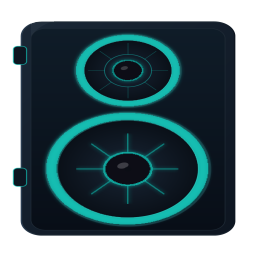
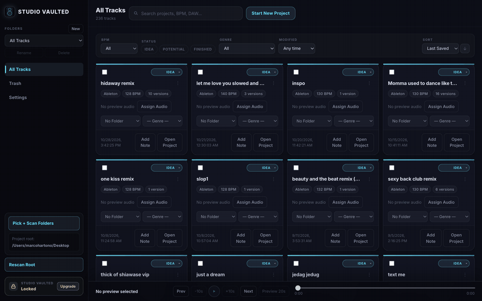
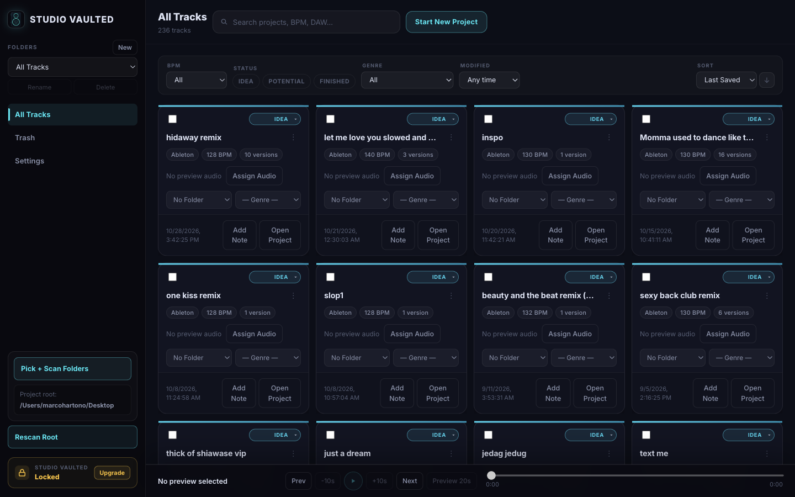
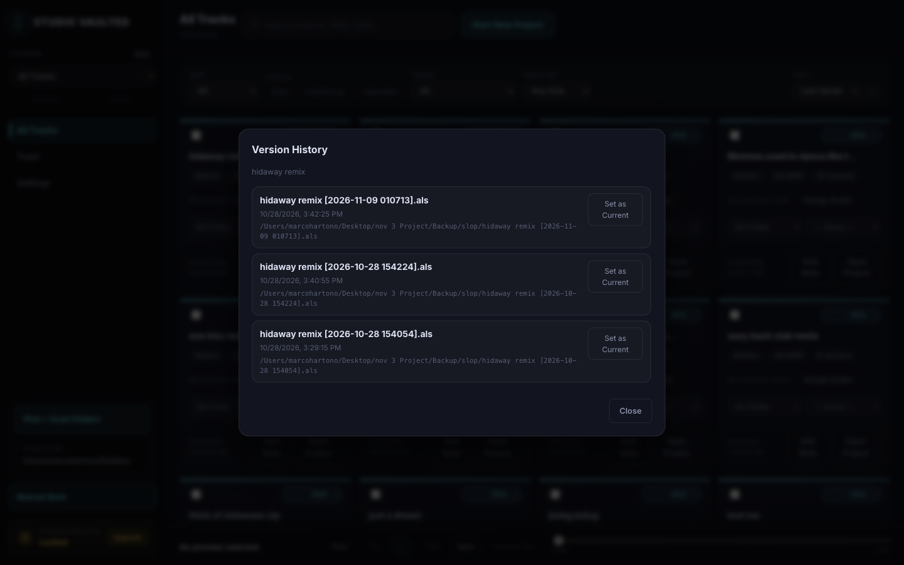
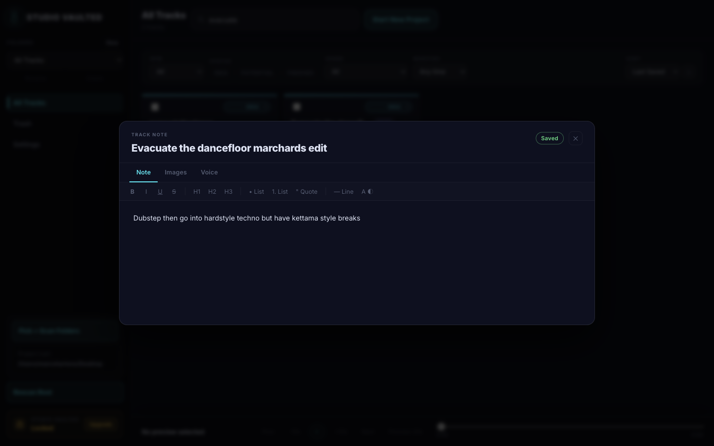
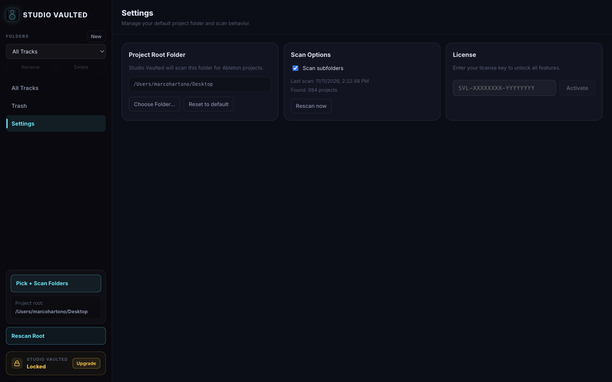

<p align="center">
  
</p>

<h1 align="center">Studio Vaulted</h1>

<p align="center">
  A library for your unfinished Ableton Live projects.<br/>
  Scan, preview, tag and pick ideas back up without opening every <code>.als</code> file.
</p>

<p align="center">
  <a href="https://github.com/marcohartono/Studio-Vaulted-app/releases/latest"><strong>Download for macOS</strong></a>
</p>

<p align="center">
  
</p>

## Why

Most producers have hundreds of half-finished Ableton projects spread across folders, each with a pile of
timestamped backup versions. Studio Vaulted indexes them into one place so you can browse, listen and organise
your ideas the way you'd organise notes.

## Features

- **Project library scanner:** point it at one or more folders and it finds every Ableton `.als` project, recursively, and keeps the index up to date.
- **Version grouping:** Ableton's `track [2025-11-27 015200].als` backups collapse under a single project with a readable version history.
- **Instant audio preview:** attach a bounce or export to a project and play it straight from the library.
- **BPM and genre tagging:** BPM is read from the project automatically where possible and can be edited by hand. Filter and group by tempo or genre.
- **Folders and status:** sort ideas into folders like *Ideas*, *DJ Tools*, *Collabs* or *Finished*. Deleted items go to a recoverable trash.
- **Track notes:** keep rich notes and media (references, screenshots, lyrics) attached to each project.
- **New projects from templates:** start a new Ableton project from your own templates, saved where you choose.
- **One-click open:** open a project in Ableton or reveal it in Finder.

## Screenshots

| Library | Versions |
| --- | --- |
|  |  |

| Notes | Settings |
| --- | --- |
|  |  |

## Install

1. Download the latest `.dmg` from [Releases](https://github.com/marcohartono/Studio-Vaulted-app/releases/latest).
2. Open it and drag **Studio Vaulted** into Applications.
3. Launch it and choose the folder(s) where you keep your Ableton projects.

**Requirements:** macOS (Apple Silicon) and Ableton Live projects (`.als`). Other DAWs aren't supported yet.

## Development

Requires Node.js 20+.

```bash
npm install
npm run dev     # start the app with hot reload
npm run lint
npm run build   # type-check, bundle and package into release/<version>/
```

### Project layout

```
electron/          Electron main process: scanning, SQLite, BPM detection, licensing, IPC
src/               React renderer (UI)
build/icons/       App icons used by electron-builder
license-server/    Express + SQLite service that issues and activates license keys
my-app/            Web checkout (Next.js + Stripe) and supporting packages
```

### Stack

Electron, React, TypeScript, Vite, SQLite, electron-builder.
